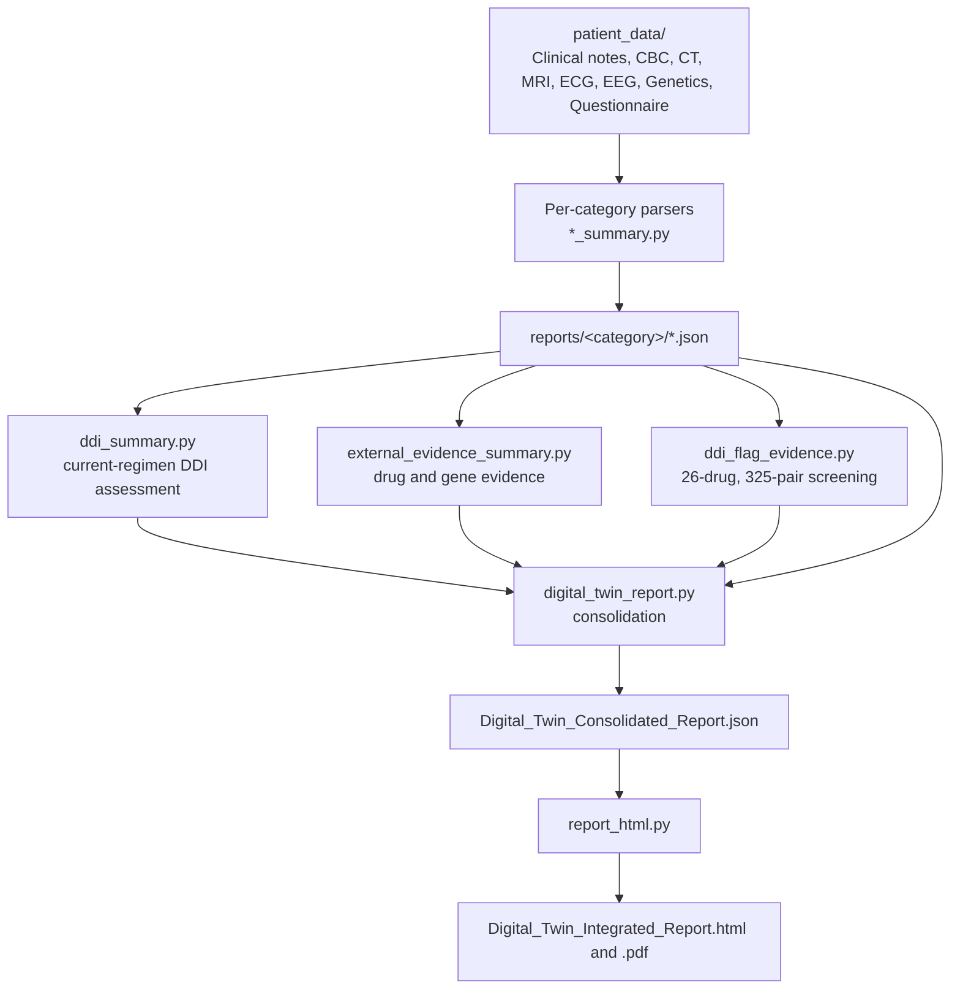

# Prime Agent — Patient Digital Twin Report Generator

> **Synthetic data only.** Every source file in `patient_data/` is labelled `SYNTHETIC TEST DATA - NOT A REAL MEDICAL RECORD`. This is a research/engineering project. It is **not** a medical device and does **not** give medical advice.

## Table of contents

1. [What this project does](#1-what-this-project-does)
2. [Key features](#2-key-features)
3. [Technologies, libraries and APIs](#3-technologies-libraries-and-apis)
4. [How it works (architecture and workflow)](#4-how-it-works-architecture-and-workflow)
5. [Folder structure](#5-folder-structure)
6. [Prerequisites](#6-prerequisites)
7. [Installation](#7-installation)
8. [Configuration (API keys and environment variables)](#8-configuration-api-keys-and-environment-variables)
9. [Quick start — generate the full report](#9-quick-start--generate-the-full-report)
10. [Running individual scripts](#10-running-individual-scripts)
11. [The Drug Interaction Flag Sheet in detail](#11-the-drug-interaction-flag-sheet-in-detail)
12. [External evidence layer](#12-external-evidence-layer)
13. [Running the tests](#13-running-the-tests)
14. [Where caches and outputs live](#14-where-caches-and-outputs-live)
15. [Troubleshooting](#15-troubleshooting)
16. [Known limitations](#16-known-limitations)

---

## 1. What this project does

Prime Agent turns a patient's raw medical files — clinical notes, CBC lab results, CT, MRI, ECG, EEG, a genetics spreadsheet and a questionnaire — into:

- a validated, machine-readable **Digital Twin JSON**, and
- a doctor-facing **HTML + PDF report**.

It also makes live calls to public biomedical sources (PubMed, ClinVar, DailyMed, CPIC, ClinicalTrials.gov and, as a general web search, Tavily) to add two kinds of evidence:

1. **External evidence for the patient's own drugs and genes** — citations, variant classifications and guideline lookups.
2. **A drug–drug interaction (DDI) screening panel** — every unique pair across a curated 26-drug list (325 pairs) is checked against several evidence sources, and each pair that the evidence resolves is classified **Positive Impact** or **Negative Impact**.

**The one rule the whole codebase follows: never invent a value.** If a fact is not in the source data, or a live API did not actually return it, the output says so (`null`, `"Not available"`, `"UNRESOLVED"`, or the pair is simply left out). "Nothing found" is never presented as "no interaction".

## 2. Key features

| Feature | What it gives you |
| --- | --- |
| Eight per-category parsers | Clinical notes, CBC, CT, MRI, ECG, EEG, genetics and questionnaire files become structured JSON under `reports/<category>/` |
| Consolidated Digital Twin | One merged JSON (`reports/Digital_Twin_Consolidated_Report.json`) validated against `schemas/` |
| HTML + PDF report | `reports/Digital_Twin_Integrated_Report.html` and `.pdf`, with numbered sections |
| Drug Interaction Flag Sheet | Pair-by-pair Positive / Negative findings, each tied to the source that produced it |
| Pair-specific evidence rules | Animal studies, comparator-only studies, three-drug studies, retracted papers and look-alike drugs (for example a racemate versus its single-enantiomer form) are rejected |
| Evidence typing | Each finding is typed: pharmacokinetic, pharmacodynamic, adverse effect, no interaction, mixed, or conflicting sources |
| Efficacy ≠ interaction | A trial that only shows a combination treated a condition is listed separately and never counted as a Positive interaction |
| Source authority | Labels and published studies outrank general web search; web search never supplies dose advice and never overrides a stronger source |
| Patient PGx as context | The patient's own pharmacogenomic findings are shown beside a pair but never decide its verdict |
| Guardrails and caching | Input allow-list, output sanitising, URL-domain checks, on-disk response cache and a 30-day lookup memory |
| Rules-only skill file | `skills/patient_prime_agent/ddi-therapeutic-response/SKILL.md` is the written specification the DDI Finding Agent follows |

## 3. Technologies, libraries and APIs

**Language:** Python 3.11 or newer.

**Libraries** (installed by `requirements.txt`):

| Library | Used for |
| --- | --- |
| `pypdf` | Reading PDF inputs and merging the report PDF |
| `openpyxl` | Reading the genetics `.xlsx` |
| `reportlab` | PDF overlay (page furniture) |
| `Pillow` | Image handling |
| `openai` | The DDI Finding Agent (OpenAI Responses API) |
| `pytest` | Tests |

Optional, not needed for the report: `gpt4all` + `huggingface_hub` (local GGUF model), `torch`, `transformers`, `accelerate`, `sentencepiece`, `psutil` (local Hugging Face models for the optional agent runtime), `bitsandbytes` (4-bit, CUDA only).

**Model:** the DDI Finding Agent uses OpenAI `gpt-5.5` with low reasoning effort by default. Both can be changed with environment variables (section 8).

**External sources:**

| Source | Needs a key? | Used for |
| --- | --- | --- |
| PubMed (NCBI E-utils) | No | Citations and abstracts for a drug, gene or drug pair |
| ClinVar (NCBI E-utils) | No | Variant classifications by gene |
| DailyMed (NLM) | No | Official drug labels, including the Drug Interactions section |
| CPIC | No | Gene–drug guideline lookups |
| ClinicalTrials.gov (API v2) | No | Trials of a drug pair |
| Tavily (general web search) | `TAVILY_API_KEY` (optional) | Lowest-priority, always labelled "General web search (Tavily)" |
| OpenAI | `OPENAI_API_KEY` (**required** for the Flag Sheet) | The Finding Agent |

**PDF rendering** uses headless **Microsoft Edge**, which ships with Windows.

## 4. How it works (architecture and workflow)



In order:

1. **Parse** — one script per category reads `patient_data/` and writes JSON to `reports/<category>/`.
2. **Evidence layers** (each reads the parsers' output):
   - `ddi_summary.py` — the DDI assessment for the patient's *current* medications.
   - `external_evidence_summary.py` — live citations/labels/guidelines for the patient's drugs and genes.
   - `ddi_flag_evidence.py` — the wide screening panel, classified by the Finding Agent.
3. **Consolidate** — `digital_twin_report.py` merges everything verbatim into one JSON. A source that has not been generated yet is listed under `source_manifest.sections_missing`, never faked.
4. **Render** — `report_html.py` writes the HTML and prints it to PDF with headless Edge.

There is also a separate, independent **Path A** (`python -m patient_prime_agent`, or `prime-agent run`) that reads the same source files and writes its own file, `reports/Digital_Twin_Integrated_Report.json`. It never feeds the consolidation above.

**Two different DDI pipelines, not duplicates:**

| | `ddi_summary.py` | `ddi_flag_evidence.py` (Flag Sheet) |
| --- | --- | --- |
| Scope | The patient's actual current regimen only | A 26-drug panel, all 325 unique pairs |
| Output | `reports/ddi/DDI_Clinical_Assessment.json` | `reports/drug_interaction_flags/Flag_Sheet_Live_Evidence.json` |
| Report section | "Drug Interactions" | "Drug Interaction Flag Sheet" |

## 5. Folder structure

```
Prime Agent/
├── patient_prime_agent/          # the Python package
│   ├── agentic/                  # Prime Agent runtime (drives Path A)
│   ├── core/                     # config, models, utilities
│   ├── external_lookup/          # PubMed, ClinVar, DailyMed, CPIC, ClinicalTrials.gov, Tavily clients,
│   │                             #   plus guardrails.py, http_client.py (cache), memory_store.py
│   ├── path_a/                   # Path A engine and extractors
│   ├── path_d/ddi/               # DDI engine: normalizer, pairing, reference data, pharmacodynamic rules,
│   │                             #   candidate_drugs.py (the 26-drug panel), finding_agent.py (OpenAI agent)
│   ├── validation/               # JSON-schema validation and repair
│   ├── *_summary.py              # the eight per-category parsers, ddi_summary.py, external_evidence_summary.py
│   ├── ddi_flag_evidence.py      # Flag Sheet entry point
│   ├── digital_twin_report.py    # consolidation entry point
│   └── report_html.py            # HTML + PDF rendering entry point
├── patient_data/                 # source files, one folder per category
├── reports/                      # every generated output (JSON, HTML, PDF)
├── schemas/                      # one *.schema.json per category + the digital twin schema
├── skills/                       # SKILL.md files (DDI rules spec lives in skills/patient_prime_agent/)
├── memory/                       # persistent state for the agent runtime
├── tests/                        # pytest suite
├── neurotwin_cpic_db/            # separate CPIC database project (not used by the commands below)
├── requirements.txt              # one-file dependency install
├── pyproject.toml                # package metadata, entry points, pytest config
└── .env.example                  # configuration template
```

## 6. Prerequisites

- **Python 3.11+** (`python --version`)
- **Windows** for PDF output (Microsoft Edge is used to print the PDF). The JSON stages run anywhere Python runs.
- **An OpenAI API key** with available budget, to run the Flag Sheet (section 8).
- Optional: a **Tavily API key** to enable the general web search source.
- Internet access (the evidence stages call public APIs).

## 7. Installation

Run these from the project root (the folder that contains `pyproject.toml`).

**Windows (PowerShell)**

```powershell
python -m venv .venv
.\.venv\Scripts\Activate.ps1
python -m pip install --upgrade pip
pip install -r requirements.txt
```

If PowerShell blocks the activation script, run `Set-ExecutionPolicy -Scope Process Bypass` first. In Command Prompt use `.venv\Scripts\activate.bat`.

**macOS / Linux**

```bash
python3 -m venv .venv
source .venv/bin/activate
python -m pip install --upgrade pip
pip install -r requirements.txt
```

`requirements.txt` installs the libraries in section 3 and the project itself (`-e .`), so `python -m patient_prime_agent.<module>` works from anywhere. Alternatively `pip install -e ".[api,test]"` installs the same set from `pyproject.toml`.

Check it worked — the prompt starts with `(.venv)` and this prints `ok`:

```powershell
python -c "import patient_prime_agent; print('ok')"
```

## 8. Configuration (API keys and environment variables)

Settings are read from the environment, or from a `.env` file in the project root. `.env` is git-ignored, so your keys are never committed.

Create a file named `.env` in the project root:

```
OPENAI_API_KEY=your-openai-key-here
TAVILY_API_KEY=your-tavily-key-here
```

- `OPENAI_API_KEY` is **required** for `ddi_flag_evidence`. Without it the run stops with an error rather than silently falling back to keyword matching.
- `TAVILY_API_KEY` is optional. If it is missing, the general web source reports `missing_api_key` and the other sources keep working.
- `.env.example` lists the optional settings of the agent runtime. If you copy it, check that every key in it is replaced with your own and that no real key is left in it.

| Variable | Default | Meaning |
| --- | --- | --- |
| `OPENAI_API_KEY` | — | OpenAI key for the Finding Agent |
| `PRIME_AGENT_LLM_PROVIDER` | `openai` | Finding Agent backend: `openai` or `gguf` (local model) |
| `PRIME_AGENT_OPENAI_MODEL` | `gpt-5.5` | OpenAI model used by the Finding Agent |
| `PRIME_AGENT_OPENAI_REASONING_EFFORT` | `low` | Reasoning effort for the Finding Agent |
| `TAVILY_API_KEY` | — | Enables the general web search source |
| `PRIME_AGENT_ENABLE_LLM` | `0` | Optional advisory narration in the Path A agent runtime |
| `PRIME_AGENT_MODEL_ID`, `PRIME_AGENT_DEVICE`, `PRIME_AGENT_DTYPE`, `PRIME_AGENT_LOAD_IN_4BIT`, `PRIME_AGENT_MAX_NEW_TOKENS`, `PRIME_AGENT_TEMPERATURE`, `PRIME_AGENT_TOP_P`, `PRIME_AGENT_LOCAL_FILES_ONLY`, `PRIME_AGENT_HF_CACHE_DIR`, `PRIME_AGENT_MAX_RETRIES`, `PRIME_AGENT_REFINEMENT_THRESHOLD`, `PRIME_AGENT_MAX_WORKERS` | see `.env.example` | Local-model and agent-runtime tuning, not needed for the report |

`ddi_flag_evidence` sets `PRIME_AGENT_DDI_FINDING_AGENT=1` itself; you do not need to.

## 9. Quick start — generate the full report

Run these in order from the project root, with the virtual environment active. Every command writes its output to `reports/`.

```powershell
# 1. Parse each category (clinical_notes and genetics must run before the DDI stages)
python -m patient_prime_agent.clinical_notes_summary
python -m patient_prime_agent.cbc_summary
python -m patient_prime_agent.ct_scan_summary
python -m patient_prime_agent.mri_summary
python -m patient_prime_agent.ecg_summary
python -m patient_prime_agent.eeg_summary
python -m patient_prime_agent.genetics_summary
python -m patient_prime_agent.questionnaire_summary

# 2. Evidence layers
python -m patient_prime_agent.ddi_summary
python -m patient_prime_agent.external_evidence_summary
python -m patient_prime_agent.ddi_flag_evidence      # slow and paid: see the note below

# 3. Merge and render
python -m patient_prime_agent.digital_twin_report
python -m patient_prime_agent.report_html
```

| Step | Writes | Rough time and cost |
| --- | --- | --- |
| `*_summary.py` parsers | `reports/<category>/*.json` | seconds each, no cost |
| `ddi_summary` | `reports/ddi/DDI_Clinical_Assessment.json` | seconds, no cost |
| `external_evidence_summary` | `reports/external_evidence/External_Evidence_Report.json` | minutes (live APIs; cached afterwards) |
| `ddi_flag_evidence` | `reports/drug_interaction_flags/Flag_Sheet_Live_Evidence.json` | about 25 minutes and a few US dollars of OpenAI usage with a warm cache |
| `digital_twin_report` | `reports/Digital_Twin_Consolidated_Report.json` | seconds |
| `report_html` | `reports/Digital_Twin_Integrated_Report.html` and `.pdf` | seconds |

**Shortcuts**

- Only the layout or wording of the report changed? Run just `python -m patient_prime_agent.report_html`. It reads the existing JSON, so it is instant and free.
- Re-run `ddi_flag_evidence` only when the evidence or the DDI rules changed. A normal re-run reuses the cached sources.

**Expected output of the last two steps**

```
Wrote consolidated Digital Twin report to reports\Digital_Twin_Consolidated_Report.json
Wrote Digital Twin PDF report to reports\Digital_Twin_Integrated_Report.pdf
```

**Expected output of `ddi_flag_evidence`** (the numbers differ from run to run):

```
Wrote Flag Sheet live evidence to reports\drug_interaction_flags\Flag_Sheet_Live_Evidence.json (N pairs with evidence / 325 checked, M dropped as unresolved)
Per-source hit counts: PubMed=… DailyMed=… ClinicalTrials.gov=… Tavily=…
Classification: finding_agent (openai/gpt-5.5): the agent decides each pair's Impact and writes its Finding from that pair's own evidence (SKILL.md Part 6)
Finding Agent outcomes: {...}
Sources rejected (reason counts): {...}
```

### Path A (independent pipeline)

```powershell
python -m patient_prime_agent                 # legacy harness
python -m patient_prime_agent --agentic       # same output, driven by the agent runtime
prime-agent run                               # console script for the agent runtime
prime-agent status                            # runtime / harness / model / refinement status
```

`prime-agent` also has the sub-commands `model`, `harness`, `sessions`, `refinements`, `memory` and `init-env` (run `prime-agent --help`). Path A writes `reports/Digital_Twin_Integrated_Report.json` and does not touch the consolidated report.

## 10. Running individual scripts

Every script is run as `python -m patient_prime_agent.<name>`, and `--help` lists its options.

| Script | Purpose | Options |
| --- | --- | --- |
| `clinical_notes_summary` | Parse clinical-note PDFs | `--input-dir`, `--output` |
| `cbc_summary` | Parse CBC PDFs | `--input-dir`, `--output` |
| `ct_scan_summary` | CT summary | `--input-dir`, `--template`, `--output` |
| `mri_summary` | MRI summary | `--input-dir`, `--output` |
| `ecg_summary` | ECG summary | `--input`, `--output` |
| `eeg_summary` | EEG summary | `--input-dir`, `--output` |
| `genetics_summary` | Pharmacogenomic interpretation from the spreadsheet | `--input`, `--output` |
| `questionnaire_summary` | Parse questionnaire PDFs | `--input-dir`, `--output` |
| `ddi_summary` | DDI assessment of the current regimen | `--clinical-notes`, `--genetics`, `--eeg`, `--ecg`, `--cbc`, `--external-evidence`, `--output` |
| `external_evidence_summary` | Live evidence for the patient's drugs and genes | `--clinical-notes`, `--genetics`, `--output`, `--cache-dir`, `--refresh`, `--retmax` |
| `ddi_flag_evidence` | Flag Sheet (26-drug screening) | `--clinical-notes`, `--genetics`, `--output`, `--refresh`, `--legacy-keyword-classifier`, `--dedupe-existing` |
| `digital_twin_report` | Merge everything into one JSON | `--project-root`, `--output` |
| `report_html` | Render HTML + PDF | `--input`, `--output` |

Options of `ddi_flag_evidence`:

```powershell
python -m patient_prime_agent.ddi_flag_evidence                        # normal run (uses cached sources)
python -m patient_prime_agent.ddi_flag_evidence --refresh              # ignore the 30-day cache and re-query every source
python -m patient_prime_agent.ddi_flag_evidence --legacy-keyword-classifier   # offline/testing only: keyword matching, no OpenAI
python -m patient_prime_agent.ddi_flag_evidence --dedupe-existing      # no live calls; remove duplicate pairs from an existing output
```

`--legacy-keyword-classifier` does **not** apply the pair-specific evidence rules and exists only for offline runs and tests. By default the Finding Agent is required.

## 11. The Drug Interaction Flag Sheet in detail

`ddi_flag_evidence.py` checks every unique pair of a 26-drug panel (the patient's current medications plus candidates from `path_d/ddi/candidate_drugs.py`): 26 drugs give 325 unordered pairs. **Drug A + Drug B and Drug B + Drug A are one pair**, counted once and shown once.

**Source order for each pair** (a later source is only used when an earlier one did not resolve the pair, except that conflicts between reliable sources are detected, see below):

1. Curated reference — the Flockhart CYP-pathway table and pharmacodynamic class rules (static, hand-curated).
2. DailyMed — the real Drug Interactions section of each drug's label.
3. PubMed, then ClinicalTrials.gov (trials need posted results).
4. General web search (Tavily) — only when nothing above resolved the pair.

The patient's own PGx findings are shown beside a pair as context. They never classify it.

**Evidence checks (applied before and after the Finding Agent):**

| Check | What it rejects |
| --- | --- |
| Human evidence only | Animal and cell/in-vitro studies |
| Exactly two drugs | Studies involving a third drug |
| Pair identity | A finding that names a related substance (for example a racemate when the pair names its single enantiomer) |
| Combination ≠ comparison | Head-to-head or comparator-only studies |
| Retraction | Retracted papers |
| Grounding | Numbers, wording and advice that are not in the source |
| Advice | Dose, monitoring or avoidance advice the source does not state, and any advice from general web search |
| "No interaction" | A "no interaction" finding unless the source explicitly says so |

**Evidence types and where each goes:**

| Evidence type | Impact | Where it appears |
| --- | --- | --- |
| pharmacokinetic, adverse effect | Negative | Flag Sheet |
| pharmacodynamic | Negative (or Positive if the source calls it beneficial) | Flag Sheet |
| no interaction (stated by the source) | Positive | Flag Sheet |
| mixed (benefit and risk both reported) | Negative, with every part kept in the Finding | Flag Sheet, tagged "mixed" |
| conflicting sources | Negative, with what each source found | Flag Sheet, tagged "conflicting sources" |
| combination efficacy only | None — not an interaction | Listed separately as "Combination-treatment efficacy evidence" |

Per-pair JSON keys include `impact`, `finding`, `evidence_type`, `evidence_conflict`, `evidence_sources` (each with its own `curated` / `inferred` tag), `evidence_details`, `pgx_context` and `hyperlink_url`. The top level also holds `classification_method`, `finding_agent_stats`, `source_rejection_counts`, `pgx_source` and `combination_efficacy_only`.

The governing rules are written in `skills/patient_prime_agent/ddi-therapeutic-response/SKILL.md`. Its Part 6 is read live as the Finding Agent's instructions, so editing it changes the agent's behaviour without a code change. The file contains rules only: no drug names, gene symbols, PMIDs or patient data.

## 12. External evidence layer

`patient_prime_agent/external_lookup/` makes live HTTP calls and applies the same protections to every source:

- **Input guardrail** — `validate_query_term()` only lets drug and gene names through; notes text or patient identifiers can never reach a public API.
- **Output guardrails** — `sanitize_response_field()` strips HTML/script and truncates; `validate_source_url()` confirms every URL belongs to the domain it claims.
- **Error vocabulary** — failures are `rate_limited`, `network_error`, `http_error` or `invalid_response`, never a bare "error".
- **Provenance** — each result carries `status`, `retrieved_at`, `from_cache` and a live/cached marker, shown as badges in the report.
- **Two caches** — see section 14.

## 13. Running the tests

```powershell
python -m pytest                    # default suite: 601 tests, no live network
python -m pytest -m slow            # the one live-network test (a real burst against NCBI)
python -m pytest tests/test_finding_agent.py          # a single file
python -m pytest tests/test_ddi_pair_evidence_rules.py -v   # verbose
```

The default run excludes tests marked `slow`. All external sources are mocked, and no test calls OpenAI.

| Area | Test files |
| --- | --- |
| DDI classification rules and the Finding Agent | `test_ddi_skill_rules.py`, `test_finding_agent.py`, `test_ddi_flag_evidence.py`, `test_ddi_pair_evidence_rules.py`, `test_ddi_review_fixes.py`, `test_ddi.py`, `test_ddi_external_evidence.py` |
| Report rendering | `test_report_html_ddi_therapy.py`, `test_report_html_external_evidence.py`, `test_report_html_section_order.py` |
| External sources and guardrails | `test_external_lookup.py`, `test_external_lookup_guardrails.py`, `test_external_lookup_sanitization.py`, `test_external_lookup_memory.py`, `test_external_lookup_ratelimit.py`, `test_search_tools.py`, `test_external_evidence_resource_router.py` |
| Agent runtime and Path A | `test_integration.py`, `test_persistent_subagents.py`, `test_rlm_delegation.py`, `test_a2a.py`, `test_harness_crud.py`, `test_memory_refinement.py`, `test_model_loader.py`, `test_schema_validation.py` |

Expected result: `601 passed, 1 deselected`. One test, `test_build_report_reuses_the_memory_store_cache_on_a_second_run`, is occasionally flaky (an off-by-one count); re-running it on its own passes. The eight per-category parsers and the consolidation step have no automated tests; they were checked by reviewing the generated output.

## 14. Where caches and outputs live

| What | Path | In git? |
| --- | --- | --- |
| Raw HTTP response cache (one JSON per request, no expiry) | `reports/external_evidence/.cache/` | No (git-ignored) |
| Lookup memory (30-day TTL) | `reports/external_lookup/memory/memory_store.json` | No (git-ignored) |
| Local GGUF model weights | `reports/external_lookup/.gguf_models/` | No (git-ignored) |
| Per-category reports | `reports/<category>/` | Yes |
| DDI assessment | `reports/ddi/DDI_Clinical_Assessment.json` | Yes |
| Flag Sheet | `reports/drug_interaction_flags/Flag_Sheet_Live_Evidence.json` | Yes |
| Final report | `reports/Digital_Twin_Integrated_Report.html` and `.pdf` | Yes |

To force fresh data, run a stage with `--refresh`, or delete the contents of `reports/external_evidence/.cache/`. A new machine has no cache, so its first `ddi_flag_evidence` run fetches everything and takes longer.

## 15. Troubleshooting

| Symptom | Likely cause and fix |
| --- | --- |
| `ERROR: The Finding Agent failed on N of M calls (RateLimitError)` and no report is written | The pipeline stops on purpose instead of writing a report with silently missing pairs. Check `OPENAI_API_KEY` and your OpenAI usage limit; the error code `organization_spend_limit_exceeded` means the spending cap was reached and must be raised in the OpenAI dashboard (Settings → Limits) for the same organization/project as the key. Then re-run. |
| `OPENAI_API_KEY is not set` | Add it to `.env` in the project root, or set it in the shell: `$env:OPENAI_API_KEY="..."` (PowerShell). |
| Flag Sheet works but no web results appear | `TAVILY_API_KEY` is not set. This is optional; the other sources still work. |
| `Activate.ps1 cannot be loaded` | Run `Set-ExecutionPolicy -Scope Process Bypass`, then activate again. |
| `No module named patient_prime_agent` | The virtual environment is not active, or `pip install -r requirements.txt` was not run from the project root. |
| PDF is not produced / Edge not found | `report_html` needs Microsoft Edge at its standard Windows location or `msedge` on `PATH`. The HTML file is still written next to the PDF. |
| `ddi_flag_evidence` is very slow | Expected on the first run (hundreds of live lookups). Later runs reuse the cache; do not add `--refresh` unless you need fresh data. |
| Some pairs are missing from the Flag Sheet | By design: a pair no source resolved is left out and counted as unresolved. "Not listed" means "no evidence found for this exact pair", never "confirmed safe". |
| A pair that used to appear is now missing | The pair-specific rules reject animal, third-drug, comparator-only and related-substance evidence; see `source_rejection_counts` in the Flag Sheet JSON for the counts per reason. |
| A ClinicalTrials.gov link opens in a browser but returns 403 inside a PDF viewer | A bot-protection quirk of that site for embedded viewers. Open the PDF in a real browser. |
| A test fails once with a count off by one | `test_build_report_reuses_the_memory_store_cache_on_a_second_run` is occasionally flaky; re-run it alone. |

## 16. Known limitations

- **Unresolved is not safe.** A pair that no source resolved is excluded, not shown as "no concern". Whether to show unresolved pairs in a labelled row is an open product question (SKILL.md, Part 4).
- **The two-drug and related-substance checks only know the screened drugs and the patient's PGx drugs.** There is no general drug dictionary, so a third drug outside that set is not detected.
- **The animal-study check is a heuristic.** A study that uses animals and humans passes.
- **A drug label table cell that leaves the acting drug unstated** can still be misread by the model; the agent has a guardrail for the most common form, not for every form.
- **Conflict detection** compares only a "no interaction" source with a pharmacokinetic or pharmacodynamic interaction source.
- **The Finding Agent requires a funded OpenAI account**, and a run that loses more than a quarter of its calls is aborted rather than written.
- **Per-category parsers** (CT findings come from a curated filename lookup, not image analysis; `.mat`, `.edf` and `.nii` files are never parsed directly, only their accompanying pre-computed summary JSON) and **consolidation** have no automated tests.
- **PDF rendering is Windows-only** as written (headless Microsoft Edge).
- **The Flockhart CYP table and pharmacodynamic rules are static**, hand-curated tables, not live queries. Path D's CYP450 reference covers only the drugs seen in this dataset's regimen.
- **NCBI rate limits depend on concurrency**, which is why the live rate-limit test is excluded from the default suite.
- **4-bit quantisation needs CUDA and `bitsandbytes`.** On CPU-only machines the optional advisory LLM runs in `float32`.
- **CPIC guideline content now lives on `clinpgx.org`** as well as `cpicpgx.org`; both domains are accepted.
